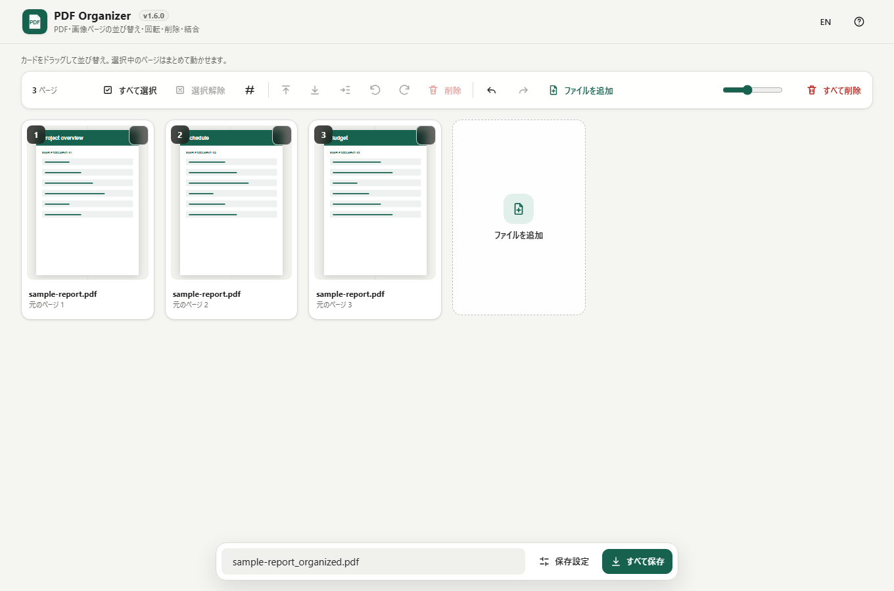

# PDF Organizer

[](https://github.com/ttomohisa/html-pdf-organizer/actions/workflows/deploy-pages.yml)
[](LICENSE)
[](https://ttomohisa.github.io/html-pdf-organizer/)

[English README](README.md)

PDFのページ、JPG/PNG/WebP画像、PowerPoint（PPTX）のスライドを、ファイルを外部へアップロードせずブラウザ内だけで整理・結合できる単一HTMLアプリです。

## 🚀 デモ

### [GitHub PagesでPDF Organizerを開く](https://ttomohisa.github.io/html-pdf-organizer/)

GitHub Pagesから最初のHTMLを読み込んだ後、PDFの読み込み・サムネイル生成・並び替え・回転・保存は端末内で処理されます。選択したPDFがサーバーへ送信されることはありません。

[](https://ttomohisa.github.io/html-pdf-organizer/)

## 主な機能

- **PDF・画像・PowerPointをひとつに整理** — 複数ファイルを混在させ、そのまま1つのPDFへまとめられます。
- **カードを動かすだけの直感的な並び替え** — 複数選択したページもまとめて移動。PCでもスマートフォンでも自然に操作できます。
- **必要な編集をすばやく** — 回転・削除・プレビュー・元に戻す／やり直すを、ページ一覧からそのまま実行できます。
- **PowerPointの情報をできるだけ保持** — スライドを高品質に再現しつつ、検索・コピー用テキストや対応図形のベクター情報をPDFへ残します。
- **保存方法も柔軟** — 全ページ／選択ページの保存、画像の配置調整、必要に応じたAES-256パスワード保護に対応します。
- **ファイルを外へ出さない単一HTML** — PDF.jsなど必要なランタイムを内包し、日本語／英語UIをブラウザだけで利用できます。

## すぐに使う

### Webで使う

[デモを開く](https://ttomohisa.github.io/html-pdf-organizer/)だけで利用できます。インストールやアカウント登録は不要です。

### ダウンロードして使う

[最新リリースの pdf-organizer.html](https://github.com/ttomohisa/html-pdf-organizer/releases/latest/download/pdf-organizer.html) をダウンロードして、最新版のChrome、Edge、Firefox、Safariのいずれかで開きます。ダウンロード後はオフラインでも利用できます。

### ソースからオフライン版をビルドする

1. このリポジトリをダウンロードまたはクローンします。
2. Windowsで `build-offline.bat` をダブルクリックします。
3. 初回だけ、`versions.json` で固定された依存パッケージを取得します。
4. 生成された `dist/index.html` を任意の場所へコピーします。
5. 以降は `dist/index.html` 単体を、インターネット接続なしで開けます。

Python、Node.js、ローカルWebサーバーは不要です。Windows標準のPowerShellと `tar.exe` を使用します。 生成物は内包ライブラリをgzip圧縮して保持し、PDF.jsの補助データは必要になったものだけ `DecompressionStream` で展開します。CMapは小さなチャンク単位でまとめて圧縮し、アプリから参照されない補助モジュールはビルド対象から外すことで、PDF表示互換性を維持したまま単一HTMLのサイズを抑えています。

## 使い方

1. PDF・JPG・PNG・WebP・PowerPoint（PPTX）を1つ以上追加します。複数ファイルをまとめてドラッグ＆ドロップできます。
2. PDFページ・画像・PowerPointスライドが同じカード一覧に並ぶので、カードをドラッグして順番を変更します。
3. 複数ページを選択し、選択中のカードをドラッグするとまとめて移動できます。
4. スマートフォンではカードを短く長押ししてから動かします。通常の縦スワイプはページスクロールになります。
5. ツールバーまたはカード上のボタンから、回転・プレビュー・削除を行います。画像カードでは `Fit` / `Fill` / `Original Size` も選べます。
6. 全ページまたは選択ページを保存します。元ファイルが1つの場合は、拡張子を除いた元ファイル名に `_organized.pdf` を付けます。複数の場合の既定名は `organized.pdf` です。スマホではページを選択すると、保存バーに **選択を保存** が現れます。

### 移動・プレビュー・分割

- ページを選択して **移動先を指定** を開き、選択していないページの番号と、その前・後ろを指定します。移動は元に戻せます。
- プレビュー内の **ページを選択** で選択を切り替えられます。スマートフォンでは、複数のファイルがある場合に元ファイル名を表示します。
- **保存設定 → 分割して保存** で次の書類が始まるページを選び、PDFごとに名前を指定してZIPで保存します。保存設定は各PDFに反映され、ページ番号は1から振り直します。同名ファイルには連番を付けます。大きなZIPはブラウザのメモリと通常のZIP形式の上限に制約されます。

### 保存オプション

保存バーの **保存設定** から透かし・ページ番号・画像圧縮・パスワードを設定できます。スマホでは保存ファイル名もここで変更できます。プレビュー上部に元ファイル名が表示されます。

**ページ番号** をオンにすると、ページ下部の中央に `1 / 24` のような番号が入ります。カードと通常のプレビューには一覧全体の番号が表示されます。選択ページだけを保存する場合は、保存するページだけに1から番号を振ります。

**画像圧縮** の初期状態はオフです。オンにすると、対象のRGB JPEG画像を再圧縮し、長辺が2,000pxを超えるものは縮小します。元から検索できるテキストや、PNGなどに由来する対象外の画像データは保持されます。PDF全体が小さくなった場合だけ圧縮版を保存し、圧縮前後のサイズを表示します。パスワードを設定した場合は、どちらも暗号化前のサイズです。

**透かし** では、「社外秘」などの定型文や宛名を入力し、実際のページで位置・色・濃さを確認して適用します。「すべて保存」「選択ページを保存」のどちらでも、保存するページに透かしが入ります。全消去または再読み込みで文言が消えます。
設定を反映すると、一覧のページカードと通常のページプレビューにも透かしが表示されます。

**パスワード** を設定すると、保存したPDFをAES-256で保護できます。パスワードはブラウザのメモリ上だけに保持され、ページを再読み込みすると消えます。

### ページ選択

- カードをクリックすると選択できます。
- 右上のチェックをクリックすると、現在の選択を残したまま追加・解除できます。
- `Ctrl` / `⌘` を押しながらクリックすると選択を追加・解除できます。
- `Shift` を押しながらクリックすると範囲選択できます。
- **ページ番号で選択**（スマホでは **その他** の中）に `2-5, 9, 12` のように入力すると、カード左上の番号を使って選択し直せます。重複は1回だけ数えます。

選択したページを、一覧での順序を保ったまま先頭・末尾へまとめて移動できます。PCではツールバーの `先頭へ` / `末尾へ`、スマートフォンでは `その他` の `選択ページを先頭へ` / `選択ページを末尾へ` を使います。回転・画像配置・選択状態はそのままで、1回の「元に戻す」で移動前に戻せます。移動の必要がない場合や読み込み・保存中は操作できません。ドラッグ中に削除や編集を行うとドラッグが取り消され、指を離しても古いページ一覧へ戻りません。

### キーボード操作

| ショートカット | 操作 |
| --- | --- |
| `Ctrl` / `⌘` + `A` | すべてのページを選択 |
| `Ctrl` / `⌘` + `Z` | 元に戻す |
| `Ctrl` / `⌘` + `Shift` + `Z` または `Ctrl` / `⌘` + `Y` | やり直す |
| `Delete` / `Backspace` | 選択ページを削除 |
| `Esc` | 選択解除またはプレビューを閉じる |
| `←` / `→` | プレビューの前後ページへ移動 |

## GitHub Pagesで公開する

このリポジトリには、完全内包版をビルドしてGitHub Pagesへ自動公開するワークフローが含まれています。

1. リポジトリ名を `html-pdf-organizer` としてGitHubへプッシュします。
2. **Settings → Pages → Build and deployment → Source** で **GitHub Actions** を選択します。
3. `main` ブランチへプッシュするか、Actions画面から **Deploy GitHub Pages** を手動実行します。
4. デプロイに成功したら、デプロイジョブに表示される公開URLを開きます。

`main` へのプッシュ時には、固定バージョンの依存パッケージから `dist/index.html` を再生成し、外部ランタイム参照が残っていないことを検査してから公開します。

詳しい手順とトラブルシューティングは [GitHub Pages公開ガイド](docs/GITHUB_PAGES.ja.md) を確認してください。

## 開発とビルド

```text
.
├─ src/index.template.html       # アプリ本体のテンプレート
├─ versions.json                 # 依存バージョンと内包対象
├─ build-offline.bat             # Windows用ビルド入口
├─ build-offline.ps1             # 完全内包HTMLの生成処理
├─ dist/index.html               # ビルド後に生成される公開物
└─ .github/workflows/
   ├─ build-offline.yml          # Pull Request時のビルド検証
   └─ deploy-pages.yml           # mainからPagesへ自動公開
```

### 依存ライブラリを更新する

`versions.json` のバージョンとファイルパスを変更し、`build-offline.bat` を再実行します。

キャッシュを破棄して再取得する場合：

```bat
build-offline.bat -ForceDownload
```

ビルド処理は以下を自動で行います。

- npm公式レジストリから固定バージョンのtarballを取得
- 依存ライブラリをgzip圧縮し、PDF.jsサポートデータは必要に応じて展開できる形で単一HTMLへ内包（CMapのみ小さなチャンク単位で圧縮）
- 依存tarball、PDF.js本体、WorkerのSHA-256を記録
- 外部スクリプト参照や未置換プレースホルダーを検査
- 生成HTMLが既定の上限4.75 MiB（4,980,736バイト）を超えた場合にビルドを停止
- PDF.jsのパッケージ構成に互換性のない変更がある場合は停止
- `dist/dependency-manifest.json` を生成

## プライバシーと通信防止

生成されたHTMLには以下が含まれます。

- `connect-src 'none'` を含むContent Security Policy
- Main ThreadとPDF.js Workerの外部 `fetch` 拒否
- HTML内データだけを返す仮想アセットローダー
- Blob URLから読み込むPDF.js本体、pdf-lib、Worker

GitHub Pages版ではページを開くためのHTML配信は発生しますが、読み込んだPDFの内容はアプリから外部へ送信されません。完全にネットワークを切って使う場合は、生成済みの `dist/index.html` をローカルで開いてください。

HTML内の `html-pdf-organizer.invalid` は仮想アセット識別用の内部キーであり、通信先ではありません。

## 制限事項

- パスワード付きPDFは、正しいパスワードを入力すると開けます。入力時のパスワードは出力へ自動では引き継がれないため、保護が必要な場合は保存時に出力パスワードを設定してください。
- PDFはWebP画像をそのまま描画する標準方式を持たないため、WebPは端末内で変換して埋め込みます。透過・ロスレスWebPはPNG、透過なしのロッシーWebPは高品質JPEGを使います。
- 電子署名付きPDFを編集すると署名は無効になります。
- しおり、添付ファイル、フォーム、電子署名などの文書レベル情報が、保存後のPDFへ引き継がれない場合があります。
- ページ数が多いPDF、高解像度画像、スライド数や図表が多いPowerPointでは、端末のメモリを多く使用します。
- PowerPointの複雑な効果・グラフ・未対応要素は見た目を優先してラスター化されます。基本図形は可能な範囲でベクターを重ね、テキストには検索・コピー用のUnicode層を追加します。
- Word（DOCX）は現時点では未対応です。
- 入力ファイルの上限は1ファイルあたり250 MiBです。

## 使用ライブラリ

| ライブラリ | バージョン | ライセンス | 用途 |
| --- | ---: | --- | --- |
| PDF.js | 6.2.108 | Apache-2.0 | PDF読み込み、サムネイル、プレビュー |
| @aiden0z/pptx-renderer | 1.2.4 | Apache-2.0 | PPTX解析、DOM/SVGプレビュー |
| pdf-lib | 1.17.1 | MIT | ページ複製、回転、PDF生成 |
| @pdfsmaller/pdf-encrypt | 1.2.0 | MIT | 出力PDFのAES-256パスワード保護 |

ドラッグ処理は外部ライブラリを使わず、Pointer Eventsで実装しています。詳細は [THIRD_PARTY_NOTICES.md](THIRD_PARTY_NOTICES.md) を確認してください。

## コントリビューション

バグ報告や機能提案はIssueからお願いします。開発への参加方法は [CONTRIBUTING.md](CONTRIBUTING.md) を確認してください。

## ライセンス

Copyright © 2026 ttomohisa

このプロジェクトは [MIT License](LICENSE) で公開されています。


## 配布ファイルの設定

`app.config.json` の `build.output` は生成先の `dist/index.html`、`build.aliases` はリポジトリで配布する `pdf-organizer.html` を示します。再ビルド後にPowerShellで `Copy-Item dist/index.html pdf-organizer.html` を実行します。メタデータのテストでは、両方のHTMLでアプリのコードと展開済みの依存ファイルが一致することを確認します。
